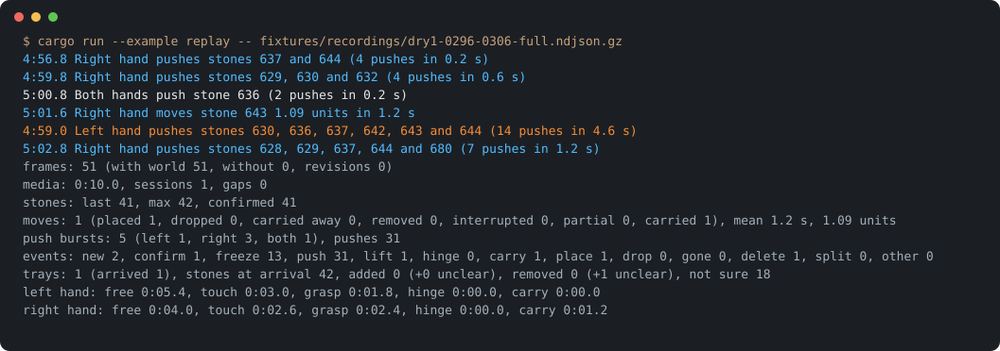
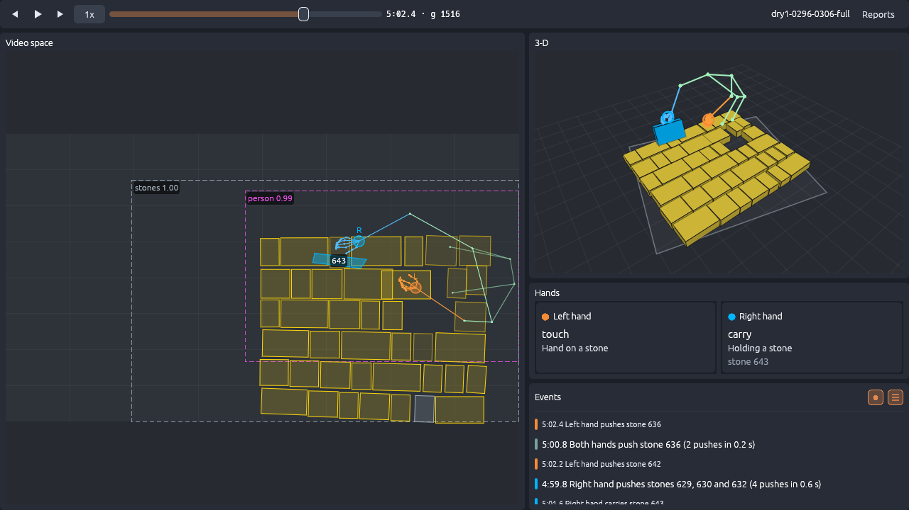

# pDigger Factory SDK for Rust

[](https://github.com/eprojac/pdigger-factory-sdk-rust/actions/workflows/ci.yml)

A pDigger Factory unit watches a work area through one camera and interprets what it sees: which hand moved which stone,
when, and where the stone went. This SDK reads that record from the unit's API (v2) in Rust, in two modes, live from a
unit or offline from a recording. Simple mode is one report per tray: which stones were taken off, which were put on and
which moved, when and where on the tray, and whether that is the tray's whole account. Advanced mode is the detail
underneath, for research and for correcting a report that is not complete: plain sentences such as `5:01.6 Right hand
lifts stone 643`, every tray fact with its reason, down to every model output. It is our SDK in Rust, one of its four
languages (Go, Python, Rust, TypeScript), which follow the same contract and print the same text for the same data. Two
crates: `pdigger-factory-sdk` (the SDK, async on tokio) and `pdigger-factory-viz` (egui widgets and the
`pdigger-factory-viewer` app, in the look of [texturecraft](https://github.com/storytold/texturecraft)).

- **Try the API in your browser:** https://factory.pdigger.com/developers/api/ (Swagger UI with a demo server that
  answers from real recordings)
- **Download the recordings:** https://factory.pdigger.com/developers/data/ (four complete recordings, every frame
  interpreted, with their summaries: dry1 on the 20.20 test unit, dry2, aug28 and jul30 in a replay of the same model
  and build on a Mac)
- **How the unit behaves**, measured, and what a live camera changes: [docs/BEHAVIOUR-20.20.md](docs/BEHAVIOUR-20.20.md)


## Install

```toml
[dependencies]
pdigger-factory-sdk = { git = "https://github.com/eprojac/pdigger-factory-sdk-rust" }
tokio = { version = "1", features = ["macros", "rt-multi-thread"] }
futures = "0.3"
```

Until the first release the crates come from this repository; from then on, from crates.io:
`pdigger-factory-sdk = "0.1"`.

The SDK needs Rust 1.88 or later and runs on tokio; HTTP is reqwest with rustls (no OpenSSL). The feature `testing`
adds the fake unit for your own tests. The visualisation crate needs Rust 1.95 (egui 0.37):

```sh
cargo add --git https://github.com/eprojac/pdigger-factory-sdk-rust pdigger-factory-viz                # the widgets
cargo install --locked --git https://github.com/eprojac/pdigger-factory-sdk-rust pdigger-factory-viz   # the pdigger-factory-viewer app
```

## Simple mode: one report per tray

<!-- example: crates/pdigger-factory-sdk/examples/quickstart_reports.rs -->
```rust
//! Simple mode: one report per tray, which stones were removed, which were added and which
//! moved, when and where, and whether that is the tray's whole account. A recording needs no unit; with
//! `--follow` the same report comes from a unit as each tray leaves.
//!
//!     cargo run --example quickstart_reports -- fixtures/recordings/dry1-0018-0153.ndjson.gz
//!     cargo run --example quickstart_reports -- --follow http://factory-orin.local:8120
use futures::StreamExt;
use pdigger_factory_sdk::{FactoryClient, Replay};

#[tokio::main]
async fn main() -> pdigger_factory_sdk::Result<()> {
    let mut args = std::env::args().skip(1);
    let source = args.next().unwrap_or_else(|| "fixtures/recordings/dry1-0018-0153.ndjson.gz".to_string());
    if source != "--follow" {
        for report in Replay::open(&source)?.tray_reports()? {
            println!("{}", report.describe());
        }
        return Ok(());
    }
    let url = args.next().unwrap_or_else(|| "http://factory-orin.local:8120".to_string());
    let factory = FactoryClient::new(&url)?;
    let mut reports = factory.interpreter().tray_reports(); // one as each tray leaves
    while let Some(report) = reports.next().await {
        println!("{}", report?.describe()); // serde_json::to_string(&report) is the same as data
    }
    Ok(())
}
```

A recording needs no unit; with `--follow` the same report comes from a unit as each tray leaves. The report of the
tray in the fixture recording `dry1-0018-0153` (dry1 from 0:18 to 2:33), real output of
`cargo run --example quickstart_reports -- fixtures/recordings/dry1-0018-0153.ndjson.gz`:

```text
tray 1 (2026-11-22T02:38:47.0Z), 0:22.5 to 2:24.0: 11 removed, 13 added, 8 moved, not complete: 18 unclear, 1 not sure
  0:45.5 removed 20261122T023847.0Z-1-117 from (0.68, -1.06) (0.98)
  0:45.5 removed 20261122T023847.0Z-1-127 from (1.14, -1.24) (0.98)
  0:59.4 removed 20261122T023847.0Z-1-126 from (0.35, -1.29) (0.98)
  1:05.4 removed 20261122T023847.0Z-1-105 from (0.49, -0.82) (0.98)
  1:23.6 removed 20261122T023847.0Z-1-112 from (-0.11, -0.84) (0.98)
  1:23.6 removed 20261122T023847.0Z-1-125 from (-0.09, -1.26) (0.98)
  2:24.0 removed 20261122T023847.0Z-1-87 from (0.02, -0.17) (unclear, 0.71)
  2:24.0 removed 20261122T023847.0Z-1-121 from (0.33, -1.27) (unclear, 0.71)
  2:24.0 removed 20261122T023847.0Z-1-128 from (0.56, -1.29) (unclear, 0.71)
  2:24.0 removed 20261122T023847.0Z-1-129 from (0.74, -1.29) (unclear, 0.71)
  2:24.0 removed 20261122T023847.0Z-1-130 from (0.87, -1.27) (unclear, 0.71)
  2:24.0 added 20261122T023943.4Z-1-151 at (0.16, -1.26) (unclear, 0.52)
  2:24.0 added 20261122T024104.0Z-1-177 at (0.02, -0.82) (unclear, 0.96)
```

These are its first fourteen lines; eleven more additions and its eight moves follow. The number that ends each change
is its confidence: how likely it is to be right, from how often changes of its kind were right on 150 trays of the four
complete recordings checked against their video. The unit's speckle check of each tray, part of every report, sets it
([docs/interpreter.md](docs/interpreter.md#confidence)). Keep the changes at or above a threshold of your own: at 0.90
this tray keeps its six certain removals and nine of its thirteen additions, all fifteen right by the camera check.
Below it are the other two stones that left (87 and 129), a stone the worker set down (278), three removals of stones
that stayed (121, 128 and 130) and three additions of stones that came in on the tray (151, 246 and 249).

The camera check is the maintainers' offline test (not published) that matches each stone's speckle in the recording's
video, the tray as it arrived against the tray as it left. The worker pushed most of the other stones while squaring the
rows up: the world lost some of them and saw them again under new ids, and the speckle check finds them again as the
tray leaves, so only one stone is still not sure (98, next to a pushed stone). A hand can also take a stone away and set
another one down in its place, so the SDK links a lost stone to a new world id only with evidence that it is the same
stone (the speckle check, their looks, or no hand near either); without it, the lost stone is removed and the new one
added, both unclear, and the stone's id never goes to another stone. Of the thirteen unclear additions, ten are stones
the worker set down and three came in on the tray. Each change gives the stone's final place on the tray, in the world's
scene units: where a removed stone was before it was taken, where an added or moved stone sits as the tray leaves, for
matching the report with another system that looks at the trays. A stone is reported moved only when the SDK is sure it
is the same stone. `not complete` says what is left open: 18 unclear changes, and 1 stone whose identity is uncertain.
Complete means complete as far as the world sees. A stone the model stops seeing for good while it stays on the tray is
removed: for certain when a hand touched it just before, else unclear (3 of the 52 certain removals in a camera check of
the four complete recordings, each one a stone a hand had moved). A box seen on an empty slot at the arrival becomes a
tray stone. A stone the world does not have as the tray leaves is not in the account. Nor is one it keeps there without
a box while a hand holds it, or with 30 % or more of its box under the box of a stone no hand holds (none here: the
camera counts 44 stones as the tray leaves, and so does the account, with world 281, which a hand set down six seconds
before and the world kept although the model had not boxed it yet)
([docs/interpreter.md](docs/interpreter.md#trays-and-tray-stones)). Advanced mode says that stone by stone ([the first
tutorial](docs/tutorials/00-start-here.md) shows how).

## Advanced mode: follow the unit

The unit interprets one shared session; this follows it and prints every event as a sentence, whatever the session
shows: a recording, or one of the plant cameras live (the 20.20 unit lists six; [Live cameras](#live-cameras-and-the-shared-session)
shows how to select one and wait out its warm-up).

<!-- example: crates/pdigger-factory-sdk/examples/quickstart.rs -->
```rust
//! Follows the shared session (a recording, or a live camera) and prints what happens on the
//! tray, as the unit's videos say it.
//!
//!     cargo run --example quickstart -- http://factory-orin.local:8120
use futures::StreamExt;
use pdigger_factory_sdk::FactoryClient;

#[tokio::main]
async fn main() -> pdigger_factory_sdk::Result<()> {
    let url = std::env::args().nth(1).unwrap_or_else(|| "http://factory-orin.local:8120".to_string());
    let factory = FactoryClient::new(&url)?;
    let mut events = factory.interpreter().events().take(20); // drop .take(20) to follow for ever
    while let Some(event) = events.next().await {
        println!("{}", event?.describe()); // 5:01.6 Right hand lifts stone 643
    }
    Ok(())
}
```

Against the fake unit that replays the fixture recording `dry1-0296-0306-full` as its camera (see
[Testing your code](#testing-your-code)), it prints the camera's events from the end of its warm-up, their media time
counted from the start of the camera session:

```text
0:03.7 stone 651 gets its final shape
0:03.9 stone 657 gets its final shape
0:03.9 stone 632 gets its final shape
0:04.3 Left hand pushes stone 637
0:04.5 Left hand pushes stone 637
...
```

The stream counts as a viewer: the unit's worker interprets only while someone watches. Dropping the stream closes
its connection.

## Advanced mode: replay a recording

The same interpreter over a recording file, offline and synchronous: its activities (moves and push bursts) and a
summary.

<!-- example: crates/pdigger-factory-sdk/examples/replay.rs -->
```rust
//! Reads a recording offline and prints its activities and its summary.
//!
//!     cargo run --example replay -- dry1.world.ndjson.gz
use pdigger_factory_sdk::Replay;

fn main() -> pdigger_factory_sdk::Result<()> {
    let path =
        std::env::args().nth(1).unwrap_or_else(|| "fixtures/recordings/dry1-0296-0306-full.ndjson.gz".to_string());
    let out = Replay::open(&path)?.run()?; // events, activities and the summary in one pass
    for activity in &out.activities {
        println!("{}", activity.describe()); // 5:01.6 Right hand moves stone 643 1.09 units in 1.2 s
    }
    print!("{}", out.summary.describe());
    Ok(())
}
```



*The real output over `fixtures/recordings/dry1-0296-0306-full.ndjson.gz` (dry1, g 1480 to 1530: the right hand
lifts, carries and places stone 643), drawn by `make pictures`.* A published recording replays the same way from its
URL, streamed and optionally paced ([examples/replay_url.rs](crates/pdigger-factory-sdk/examples/replay_url.rs),
[docs/replay.md](docs/replay.md)).

## Advanced mode, in three layers

| Level | What | Where |
|---|---|---|
| High | the interpreter: events, moves, push bursts, hands, stones, trays with stone ids never reused and facts never revised, summary, sentences, `wait_for`; sources, the live cameras, the session's controls and clock | `Interpreter`, `Replay`, `ReplayStream`, `Session`, `FactoryClient::sources` |
| Mid | frame streams that resume, backfill late layers and flag revisions; the long-poll; raw packets | `Streams` |
| Low | one method per API operation (32), typed models, one error type, retries; the codec | `Api`, `models`, `codec` |

### High level: the interpreter

The moves and push bursts as the unit's videos say them, then what each hand is doing and a summary of what was
seen:

<!-- example: crates/pdigger-factory-sdk/examples/interpreter.rs -->
```rust
//! The high level, as the unit's videos tell it: the moves and push bursts as sentences while
//! the shared session plays, then what each hand is doing and a summary of what was seen.
//!
//!     cargo run --example interpreter -- http://factory-orin.local:8120
use futures::StreamExt;
use pdigger_factory_sdk::{FactoryClient, Side, WireEnum};

#[tokio::main]
async fn main() -> pdigger_factory_sdk::Result<()> {
    let url = std::env::args().nth(1).unwrap_or_else(|| "http://factory-orin.local:8120".to_string());
    let interpreter = FactoryClient::new(&url)?.interpreter();
    let mut updates = interpreter.updates().take(30); // 30 frames: 6 s of media
    while let Some(update) = updates.next().await {
        for activity in &update?.activities {
            println!("{}", activity.describe()); // 5:01.6 Right hand moves stone 643 1.09 units in 1.2 s
        }
    }
    let state = interpreter.state();
    for (name, side) in [("Left", Side::Left), ("Right", Side::Right)] {
        let hand = state.hands.get(&side).cloned().unwrap_or_default();
        let doing = hand.state.as_ref().map_or("unseen", |s| s.as_str());
        let stone = hand.stone.map(|id| format!(", stone {id}")).unwrap_or_default();
        println!("{name} hand: {doing}{stone}");
    }
    print!("{}", interpreter.summary().describe());
    Ok(())
}
```

Sources, the live cameras and the shared session. The controls move the one session for every viewer, so this checks
them as dry runs:

<!-- example: crates/pdigger-factory-sdk/examples/session.rs -->
```rust
//! Sources, the live cameras and the shared session: its state, its clock and its controls,
//! checked as dry runs (a real control moves the one session for every viewer).
//!
//!     cargo run --example session -- http://factory-orin.local:8120
use pdigger_factory_sdk::FactoryClient;

#[tokio::main]
async fn main() -> pdigger_factory_sdk::Result<()> {
    let url = std::env::args().nth(1).unwrap_or_else(|| "http://factory-orin.local:8120".to_string());
    let factory = FactoryClient::new(&url)?;
    for source in factory.sources().await? {
        let kind = if source.is_live() { "live camera" } else { "recording" };
        println!("{:11} {kind}: {}", source.id, source.name());
    }
    match factory.live().await {
        Ok(live) => println!("first live camera: {} ({})", live.id, live.station.as_deref().unwrap_or("no station")),
        Err(e) if e.is_live_unavailable() => println!("this unit lists no camera: the shared session plays recordings"),
        Err(e) => return Err(e),
    }
    let session = factory.session();
    let state = session.state().await?;
    let clock = session.clock().await?;
    println!(
        "the session plays {} (playing: {}), media time {:.1} s",
        state.video,
        state.playing,
        clock.media_time_now()
    );
    let dry = session.dry_run(); // validated by the unit, nothing moves
    let checked = dry.watch(&state.video).await?;
    println!("watch {} (dry run): accepted, session {}", state.video, checked.session);
    if let Err(e) = dry.seek(-5.0).await {
        println!("seek to -5 s (dry run): refused, {e}");
    }
    Ok(())
}
```

### Live cameras and the shared session

The plant cameras are sources like the recordings, listed after them by their serials (`CAM00000001`):
`FactoryClient::cameras`, and `FactoryClient::live` for the first. Watching one moves the shared session for every
viewer to it: the session is `connecting` until the camera's first frame, then `warming` while the interpreter runs on
its first 3 seconds of frames (none of them is shown), then `live`, and `Session::until_live` waits for that (the select
counts as a viewer for 15 s, so this works on a unit nobody else watches):

<!-- example: crates/pdigger-factory-sdk/examples/live_camera.rs -->
```rust
//! Watch a plant camera live: select it for the shared session, wait out its warm-up, then print
//! what happens.
//!
//! Selecting a camera changes what every viewer of the unit sees (the page follows the session).
//! The unit connects to the camera, runs the interpreter on its first 3 seconds of frames to warm
//! it up, and then shows it live. Give a camera's serial to watch that one; stop it with Ctrl-C
//! (or give a number of events to stop after).
//!
//!     cargo run --example live_camera -- http://factory-orin.local:8120 [serial] [events]
use std::time::Duration;

use futures::StreamExt;
use pdigger_factory_sdk::FactoryClient;
use pdigger_factory_sdk::api::FrameSel;

/// The UTC time of day of an epoch second, `hh:mm:ss`.
fn utc(wall: f64) -> String {
    let s = wall.floor().rem_euclid(86_400.0) as u32;
    format!("{:02}:{:02}:{:02}", s / 3600, s / 60 % 60, s % 60)
}

#[tokio::main]
async fn main() -> pdigger_factory_sdk::Result<()> {
    let args: Vec<String> = std::env::args().skip(1).collect();
    let url = args.first().cloned().unwrap_or_else(|| "http://factory-orin.local:8120".to_string());
    let serial = args.get(1).filter(|s| !s.is_empty() && !s.bytes().all(|b| b.is_ascii_digit()));
    let stop_after = args.iter().skip(1).find_map(|a| a.parse::<usize>().ok()).unwrap_or(usize::MAX);
    let factory = FactoryClient::new(&url)?;

    let camera = match serial {
        Some(serial) => factory.source(serial).await?, // that camera
        None => factory.live().await?,                 // the first camera
    };
    factory.session().watch(&camera.id).await?; // connecting, then warming up on the camera's first 3 s
    let state = factory.session().until_live(Duration::from_secs(30)).await?;
    let lag = state.live.as_ref().map_or(0.0, |live| live.lag);
    println!("{} ({}) is live: session {}, {lag:.2} s behind the camera", camera.id, camera.name(), state.session);

    let picture = factory.session().picture(FrameSel::Latest).await?; // the JPEG the newest frame was interpreted from
    println!("frame g {}: a {}-byte JPEG", picture.g, picture.jpeg.len());

    let mut events = factory.interpreter().events();
    let mut shown = 0;
    while let Some(event) = events.next().await {
        let event = event?;
        let at = event.wall.map_or_else(|| "--:--:--".to_string(), utc);
        println!("{at} UTC  {}", event.describe()); // on a camera, the wall time is the timestamp that matters
        shown += 1;
        if shown >= stop_after {
            break;
        }
    }
    Ok(())
}
```

From then on the frames, the world and the events stream as on a recording, at the camera's rate as far as the worker
keeps up (1.6 to 3.9 frames a second on build `claude-20261120-looks1`; build `claude-20261122-hr4x1` interprets about
3.6 a second on a camera). A camera has no time: `watch_at(camera, Some(t))` and a seek fail with `not_seekable` without
sending the select or the seek (a seek reads the session first, a watch of an id reads the catalog; the unit refuses a
select with a time with 400 and a seek with 409), `pause` freezes the shared view, and `play` continues at the live edge
after a new warm-up. A camera has no media either: every frame comes with its picture (`Session::picture`,
`Session::picture_in` with the frame's session). Events carry a wall time from the shared state, which on a camera is
the timestamp that matters. [docs/concepts.md](docs/concepts.md#sources-and-the-live-cameras) explains the session, and
[docs/BEHAVIOUR-20.20.md](docs/BEHAVIOUR-20.20.md) gives measurements of the 20.20 unit and its live cameras.

### Trays: ids never reused, facts never revised

The world's stone ids are the engine tracker's: it renames a stone it lost and found again, and it can give a stone's id
to another one (a stone set down where a removed one lay, a row of equal stones pushed one place along). For anything
that must hold over time, use the tray stones. The interpreter follows each tray from the moment it has arrived and
settled to the moment it is about to move out, and gives every stone on it an id that is never reused, no other tray
stone is ever given it (`20261122T023847.0Z-1-117`: first seen at that UTC time, on tray 1, under world id 117). A
tray stone says whether its identity is still sure, and a fact about it is certain or unclear:
`0:45.5 tray 1: stone 20261122T023847.0Z-1-117 was removed` is certain and is never revised, and what the rules cannot
be sure of is reported as unclear, never guessed. `Replay::trays()` lists the trays with their two points, the ones to
jump between:

<!-- example: crates/pdigger-factory-sdk/examples/tray_points.rs -->
```rust
//! The trays of a recording: when each had arrived and settled, and when it was about to move
//! out, with the stones removed from it for certain. Then one tray on the shared session: its two
//! points as dry runs (a real select moves the one session for every viewer).
//!
//! The tray stones carry the SDK's own ids, one per stone and never reused, so "stone X was
//! removed" holds over time; the world's ids are the engine tracker's, which renames stones and
//! reuses ids.
//!
//!     cargo run --example tray_points -- dry1.world.ndjson.gz 2 http://factory-orin.local:8120
use pdigger_factory_sdk::interpreter::text::clock;
use pdigger_factory_sdk::{FactoryClient, Replay, TrayStoneStatus};

#[tokio::main]
async fn main() -> pdigger_factory_sdk::Result<()> {
    let mut args = std::env::args().skip(1);
    let path = args.next().unwrap_or_else(|| "fixtures/recordings/dry1-0018-0153.ndjson.gz".to_string());
    let show: i64 = args.next().and_then(|n| n.parse().ok()).unwrap_or(1);
    let url = args.next().unwrap_or_else(|| "http://factory-orin.local:8120".to_string());
    let trays = Replay::open(&path)?.trays()?; // every tray, with its two points
    for tray in &trays {
        let Some((arrived, leaving)) = tray.window() else { continue }; // a stop that never settled
        println!("tray {}: arrived {}, leaving {}", tray.n, clock(arrived), clock(leaving));
        for stone in &tray.stones {
            if stone.status == TrayStoneStatus::Removed && stone.certain == Some(true) {
                println!("  removed: {}", stone.id);
            }
        }
    }
    let Some(tray) = trays.iter().find(|t| t.n == show && t.window().is_some()) else { return Ok(()) };
    let session = FactoryClient::new(&url)?.session().dry_run(); // validated by the unit, nothing moves
    for point in [tray.arrived, tray.leaving].into_iter().flatten() {
        let would = session.watch_at(&tray.video, Some(point.t)).await?;
        println!("seek to {} would show {} from {}", clock(point.t), would.video, clock(would.anchor_media));
    }
    Ok(())
}
```

Live, `interpreter.tray_facts()` yields the same facts as frames make them, and every event names the tray stone its
world id stands for (`event.tray_stone`). On busy trays, where hands push rows of equal stones, the tray rules alone
lose track of many stones; as the tray leaves, the unit's speckle check settles most of them again (on the published
recordings 95.6 % of the stones are sure as their tray leaves where it answers), and every change carries its
confidence. Without an answer for the leaving (hands still at work after the tray's last calm frame), most of those
stones stay not sure and the stones set down are mostly reported as unclear. The SDK sees only the world: a box the
model sees on an empty slot when the tray arrives cannot be told from a stone, and a stone the model stops seeing for
good while it stays on the tray looks removed ([docs/interpreter.md](docs/interpreter.md#trays-and-tray-stones)). The
viewer jumps between the tray points with `[` and `]`, and its Reports button shows each tray's report as a picture
([docs/viz.md](docs/viz.md#reportview-a-trays-report)).

### Mid level: streams

<!-- example: crates/pdigger-factory-sdk/examples/streams.rs -->
```rust
//! The mid level: frames over SSE (resumed after a drop, late layers backfilled, revisions
//! flagged) and the long-poll alternative.
//!
//!     cargo run --example streams -- http://factory-orin.local:8120
use futures::StreamExt;
use pdigger_factory_sdk::streams::PollOptions;
use pdigger_factory_sdk::{FactoryClient, FramesOptions, Layer, StreamItem};

#[tokio::main]
async fn main() -> pdigger_factory_sdk::Result<()> {
    let url = std::env::args().nth(1).unwrap_or_else(|| "http://factory-orin.local:8120".to_string());
    let streams = FactoryClient::new(&url)?.streams();
    let options = FramesOptions { layers: vec![Layer::World, Layer::Cards], observe: Some(true), ..Default::default() };
    let mut frames = streams.frames(options).take(5);
    while let Some(item) = frames.next().await {
        match item? {
            StreamItem::Frame(item) => {
                let stones = item.frame.world.as_ref().map_or(0, |w| w.stones.len());
                println!(
                    "frame g {} at {:.1} s: {stones} stones (revision: {})",
                    item.frame.g, item.frame.t, item.is_revision
                );
            }
            StreamItem::Clock(clock) => println!("clock: {} at {:.1} s", clock.state.video, clock.state.media_time),
            other => println!("{other:?}"),
        }
    }
    let poll = PollOptions { layers: vec![Layer::World], ..Default::default() };
    let mut polled = streams.poll(poll).take(2);
    while let Some(item) = polled.next().await {
        if let StreamItem::Frame(item) = item? {
            println!("polled g {} (cursor {})", item.frame.g, item.frame.cursor);
        }
    }
    Ok(())
}
```

### Low level: one method per operation

<!-- example: crates/pdigger-factory-sdk/examples/low_level.rs -->
```rust
//! The low level: one method per API operation, typed replies, and the codec of the maps.
//!
//!     cargo run --example low_level -- http://factory-orin.local:8120
use pdigger_factory_sdk::api::{FrameQuery, FrameSel, RenderQuery};
use pdigger_factory_sdk::codec::decode_u8_map;
use pdigger_factory_sdk::{FactoryClient, Layer};

#[tokio::main]
async fn main() -> pdigger_factory_sdk::Result<()> {
    let url = std::env::args().nth(1).unwrap_or_else(|| "http://factory-orin.local:8120".to_string());
    let api = FactoryClient::new(&url)?.api();
    let root = api.get_api_root().await?;
    println!("API {}, build {}", root.api, root.build);
    let session = api.get_session().await?;
    println!("session {} plays {}, {} viewers", session.state.session, session.state.video, session.viewers);
    let query = FrameQuery { layers: vec![Layer::World, Layer::Overlay], ..Default::default() };
    let frame = api.get_frame(FrameSel::Latest, &query).await?;
    let stones = frame.world.as_ref().map_or(0, |w| w.stones.len());
    println!("newest frame: g {} at {:.1} s, {stones} stones", frame.g, frame.t);
    if let Some(overlay) = &frame.overlay {
        let regions = &overlay.regions;
        if let Some(map) = decode_u8_map(regions.stone.as_deref(), regions.rows, regions.cols)? {
            println!("stone map {}x{}: {} cells with a stone", regions.rows, regions.cols, map.count(None));
        }
    }
    let draw =
        api.render_overlay2d(&RenderQuery { session: Some(frame.session), ..RenderQuery::at_g(frame.g) }).await?;
    println!(
        "overlay2d: {} stones, {} boxes, {} wrists (g {})",
        draw.stones.len(),
        draw.boxes.len(),
        draw.wrists.len(),
        draw.g
    );
    Ok(())
}
```

## Errors

Every error is one type, `pdigger_factory_sdk::Error`, with the HTTP status, a stable `code` (`ErrorCode`) to branch
on, the server's message, the field at fault and the server's `retry_ms`; `retained()` gives the window of frames the
unit still holds. GET requests are retried on connection errors, 429, 502, 503 and 504 (3 retries, exponential backoff
from 250 ms with full jitter, honouring `retry_ms` and `Retry-After`) before an error reaches you; a control is
retried only on 429.

<!-- example: crates/pdigger-factory-sdk/examples/errors.rs -->
```rust
//! Errors: one type with a stable code to branch on. GET requests are retried (connection
//! errors, 429, 502, 503, 504) before an error reaches you; a control only on 429.
//!
//!     cargo run --example errors -- http://factory-orin.local:8120
use std::time::Duration;

use pdigger_factory_sdk::api::FrameQuery;
use pdigger_factory_sdk::models::EventKind;
use pdigger_factory_sdk::{FactoryClient, WireEnum};

#[tokio::main]
async fn main() -> pdigger_factory_sdk::Result<()> {
    let url = std::env::args().nth(1).unwrap_or_else(|| "http://factory-orin.local:8120".to_string());
    let factory = FactoryClient::new(&url)?;
    // An API error: branch on the code, never on the message.
    match factory.api().get_frame(1, &FrameQuery::default()).await {
        Ok(frame) => println!("frame 1 is still held (session {})", frame.session),
        Err(e) if e.is_not_retained() => {
            println!("frame 1: HTTP {} {}", e.status.unwrap_or(0), e.code.as_str());
            if let Some(held) = e.retained() {
                println!("the unit holds frames {:?} to {:?} of session {}", held.g0, held.g1, held.session);
            }
        }
        Err(e) => return Err(e),
    }
    // A control the unit refuses, checked as a dry run: the shared session does not move.
    if let Err(e) = factory.session().dry_run().seek(-5.0).await {
        println!("seek to -5 s: {} (retryable: {})", e.code.as_str(), e.is_retryable());
    }
    // Time limits: wait_for gives Ok(None) when nothing came in time.
    let split = factory.interpreter().wait_for(EventKind::Split, Duration::from_millis(500)).await?;
    println!("a split within 0.5 s: {}", split.is_some());
    Ok(())
}
```

## Async

- Every call that talks to the unit is an `async fn` on tokio. A `FactoryClient` is cheap to clone and can be shared
  between tasks.
- Streams are `futures::Stream`s of `Result<T>`. Dropping a stream cancels it and closes its HTTP connection; so does
  `tokio::time::timeout` or `select!` around it. Streams handle dropped connections and server restarts themselves
  (they resume with `Last-Event-ID`), yield an error for an item that does not decode and go on, and end after an
  error they cannot recover from.
- `Replay`'s `frames()`, `updates()`, `events()` and `activities()` are synchronous iterators (no runtime needed);
  `ReplayStream` is the async variant, streamed from a file or a URL and optionally paced in real time.
- The interpreter's rules live in `InterpreterCore`, which is synchronous and does no I/O: feed it frames from
  anywhere.
- Time and randomness are injectable (`ClientBuilder::clock`, `ClientBuilder::random`), so code built on the SDK
  tests deterministically.

## Visualisation



*`pdigger-factory-viewer` on the fixture recording `dry1-0296-0306-full` at g 1516 (5:02.4), while the right hand
carries stone 643; rendered headless by [examples/screenshots.rs](crates/pdigger-factory-viz/examples/screenshots.rs).*

`pdigger-factory-viz` draws the SDK's data with egui in the look of texturecraft (its Craft theme and controls,
vendored): `OverlayView` (the video-space overlay), `SceneView` (the 3-D scene with an orbit camera), `EventFeed`,
`HandCards`, `ReportView` (a tray's report as a picture), and `ViewerApp`, which puts them together. The viewer opens a
recording file, a recording URL or a unit:

```sh
pdigger-factory-viewer fixtures/recordings/dry1-0296-0306-full.ndjson.gz
pdigger-factory-viewer https://factory.pdigger.com/developers/data/dry1.full.ndjson.gz
pdigger-factory-viewer http://factory-orin.local:8120
```

A `.world` recording carries the world and the hand cards: the viewer draws its stones in the video size its header
names, with no skeleton, wrists or boxes; the five-layer `.full` recordings add those. Following a unit, it streams the
world, cards, scene and overlay layers. `[` and `]` (or Page Up and Page Down) jump to the previous and next tray
point: a tray that has arrived and settled, or one about to move out. The Reports button lists the trays that left and
shows the report of the one picked: the tray as it arrived and as it left, from above, each stone coloured by what the
report says of it.

[docs/viz.md](docs/viz.md) shows the widgets one by one and how to render them without a window.

## Testing your code

The feature `testing` adds `FakeFactory`, a fake unit that answers the whole API from a recording and the recorded
replies, in process or on a loopback port, with fault injection and a manual clock. The code you build on the SDK
can be unit-tested without a unit, a network or a real clock:

<!-- example: crates/pdigger-factory-sdk/examples/testing_quickstart.rs -->
```rust
//! Tests your own code against the SDK's fake unit: it answers the API from a recording, in
//! process (no socket, no unit), and injects faults.
//!
//!     cargo run --example testing_quickstart --features testing
use std::time::Duration;

use pdigger_factory_sdk::models::EventKind;
use pdigger_factory_sdk::testing::{FakeFactory, Fault};

#[tokio::main(flavor = "current_thread")]
async fn main() -> pdigger_factory_sdk::Result<()> {
    let fake = FakeFactory::from_recording("fixtures/recordings/dry1-0296-0306-full.ndjson.gz")?;
    let factory = fake.client();
    let lift = factory.interpreter().wait_for(EventKind::Lift, Duration::from_secs(5)).await?.expect("a lift");
    assert_eq!(lift.describe(), "5:01.6 Right hand lifts stone 643");
    println!("{}", lift.describe());
    fake.fail("getSession", Fault::status(503, "busy").times(1)); // one 503, then the retry succeeds
    let state = factory.session().state().await?;
    println!("session {} on {} after {} requests", state.session, state.video, fake.operations().len());
    Ok(())
}
```

```toml
[dev-dependencies]
pdigger-factory-sdk = { git = "https://github.com/eprojac/pdigger-factory-sdk-rust", features = ["testing"] }
```

In your own project the recording must be there too: copy `dry1-0296-0306-full.ndjson.gz` from this repository's
`fixtures/recordings/` (the sample expects its lift), or download a published recording from
https://factory.pdigger.com/developers/data/ and test what your code makes of it.

To try the examples and the viewer without a unit, `examples/fake_server.rs` serves a recording on 127.0.0.1:

```sh
cargo run --example fake_server --features testing -- fixtures/recordings/dry1-0296-0306-full.ndjson.gz --live
cargo run --example quickstart -- http://127.0.0.1:<port it printed>
```

More in [docs/testing.md](docs/testing.md).

## Docs

- [docs/tutorials/](docs/tutorials/README.md): start here, four short tutorials (high level, low level, live cameras,
  Rust), every program in them an example that `make test` runs
- [docs/concepts.md](docs/concepts.md): the shared session, sources and the live cameras, frames and layers, cursors,
  revisions, coordinates, the template gauge
- [docs/interpreter.md](docs/interpreter.md): events, activities, trays and tray stones, their sentences, the state,
  the summary
- [docs/replay.md](docs/replay.md): recordings, offline replays, pacing, the trays of a recording
- [docs/streams.md](docs/streams.md): frame streams, resume, backfill, revisions, the long-poll, raw packets
- [docs/low-level.md](docs/low-level.md): the 32 operations, models, errors, retries, the codec
- [docs/testing.md](docs/testing.md): the fake unit, fault injection, this SDK's own tests
- [docs/viz.md](docs/viz.md): the egui widgets, the viewer, headless rendering
- The examples: [crates/pdigger-factory-sdk/examples](crates/pdigger-factory-sdk/examples) and
  [crates/pdigger-factory-viz/examples](crates/pdigger-factory-viz/examples). Every Rust block of this README and of
  `docs/` is one of them, word for word, and `make test` runs them all
- The API reference: `make docs`, or the artifact every CI run builds (docs.rs from the first release on)
- The contract the four languages share: [spec/SDK-DESIGN.md](spec/SDK-DESIGN.md); the API: [spec/openapi.yaml](spec/openapi.yaml)

## The other languages

| Language | Repository | Package |
|---|---|---|
| Go | [pdigger-factory-sdk-go](https://github.com/eprojac/pdigger-factory-sdk-go) | `github.com/eprojac/pdigger-factory-sdk-go` |
| Python | [pdigger-factory-sdk-python](https://github.com/eprojac/pdigger-factory-sdk-python) | `pdigger-factory-sdk` (`import pdigger_factory_sdk`), on PyPI from its first release |
| Rust | [pdigger-factory-sdk-rust](https://github.com/eprojac/pdigger-factory-sdk-rust) | crates `pdigger-factory-sdk` and `pdigger-factory-viz`, on crates.io from their first release |
| TypeScript | [pdigger-factory-sdk-ts](https://github.com/eprojac/pdigger-factory-sdk-ts) | `pdigger-factory-sdk` (`/viz`, `/testing`), on npm from its first release |

What every language has:

| | Go | Python | Rust | TypeScript |
|---|---|---|---|---|
| **High:** Interpreter (events, moves, push bursts, hands, stones, tracks, summary, text, `wait_for`) | ✓ | ✓ | ✓ | ✓ |
| **High:** Replay of a recording file or URL, with real-time pacing | ✓ | ✓ | ✓ | ✓ |
| **High:** Trays: stone ids never reused, certain and unclear facts never revised, arrival and leaving points | ✓ | ✓ | ✓ | ✓ |
| **High:** sources and the live cameras (warm-up, pictures), the shared session's controls (with `dry_run`), its clock | ✓ | ✓ | ✓ | ✓ |
| **Mid:** frame streams that resume (`Last-Event-ID`) and backfill late layers; long-poll; raw packets | ✓ | ✓ | ✓ | ✓ |
| **Mid:** render-ready overlay2d and scene3d draw lists, typed | ✓ | ✓ | ✓ | ✓ |
| **Low:** one method per API operation (32), typed models and errors, retries | ✓ | ✓ | ✓ | ✓ |
| **Low:** codec (maps, bitsets, depth, surfaces, joints, stone tuples, coordinates) | ✓ | ✓ | ✓ | ✓ |
| `testing`: a fake server that answers from recordings, with fault injection | ✓ | ✓ | ✓ | ✓ |
| Visualisation helpers | | | egui: overlay, 3-D, events, hands, viewer app | three.js: scene, overlay canvas, event feed |
| Async | `context`, `iter.Seq2` | `asyncio` | `async fn`, `Stream` | `Promise`, `AsyncIterable`, `AbortSignal` |
| Required unit-test coverage in Docker | 100 % | 100 % | 100 % | 100 % |

The same names in every language, in each one's own case: `list_videos` here is `ListVideos` in Go and `listVideos`
in TypeScript.

## Development

```sh
make test       # in Docker, no network: every test, 100 % line and function coverage, golden outputs, doc tests, examples
make lint       # rustfmt and clippy -D warnings
make docs       # the API reference (rustdoc) in target/doc
make examples   # the examples against the fixtures and the fake unit, with a local toolchain
make pictures   # redraws the pictures of docs/img from the fixture recordings (architecture.* comes from the maintainers)
make viewer     # the viewer on a fixture recording (needs a display)
```

[TESTING.md](TESTING.md) says what the tests cover, what coverage leaves out and how to run the opt-in suites against
a unit or the complete recordings. [CONTRIBUTING.md](CONTRIBUTING.md) has the rules for changes and releases,
[CHANGELOG.md](CHANGELOG.md) the releases.

## Licence

Apache-2.0: see [LICENSE](LICENSE) and [NOTICE](NOTICE). The visualisation crate vendors parts of texturecraft and
craft-libs (MIT OR Apache-2.0), listed in NOTICE.
