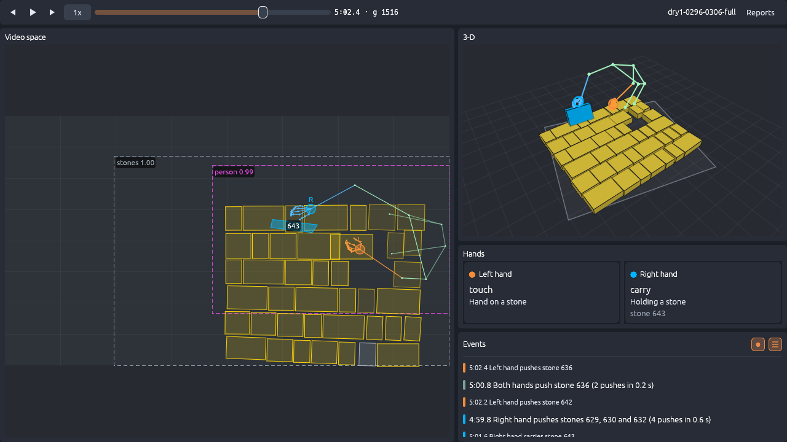

# pdigger-factory-viz

egui widgets for the [pDigger Factory SDK](https://crates.io/crates/pdigger-factory-sdk), in the look of
[texturecraft](https://github.com/storytold/texturecraft), and the `pdigger-factory-viewer` app.



*The viewer on the fixture recording `dry1-0296-0306-full` at g 1516 (5:02.4), while the right hand carries stone 643.*

- `OverlayView`: the video-space overlay (stones, boxes, skeleton, wrist rings, the focus, primitives), with hover
  picking.
- `SceneView`: the 3-D scene (board, stones as boxes, the focus path, skeleton, wrist rings) through an orbit camera.
- `EventFeed` and `HandCards`: the interpreter's sentences, and what each hand is doing.
- `ReportView`: a tray's report as a picture, the tray as it arrived and as it left, from above, its stones coloured by
  what the report says of them (`report_marks`, `REPORT_COLORS`), the changed ones labelled, with the report's text.
- `ViewerApp`: all of them with playback controls, over a replay or a unit followed live, and the reports of the trays
  that left. It interprets a whole recording before it shows it: `dry1.world` (9,042 frames) takes about 14 s and
  1.5 GB of memory in a release build.
- `raster::render`: any of them rendered without a window or a GPU (for tests and pictures).

```sh
cargo install pdigger-factory-viz
pdigger-factory-viewer https://factory.pdigger.com/developers/data/dry1.world.ndjson.gz
pdigger-factory-viewer http://factory-orin.local:8120
```

Rust 1.95 or later (egui 0.37). The Craft theme, icon buttons and split layout are vendored from TextureCraft and
craft-libs (craft-ui) (MIT OR Apache-2.0; see NOTICE). Guide:
https://github.com/eprojac/pdigger-factory-sdk-rust/blob/main/docs/viz.md

Licensed under Apache-2.0.
