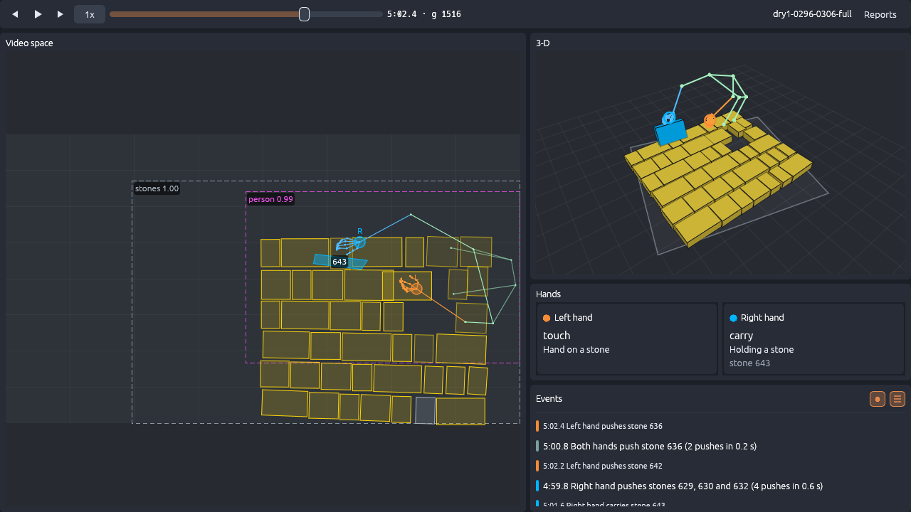
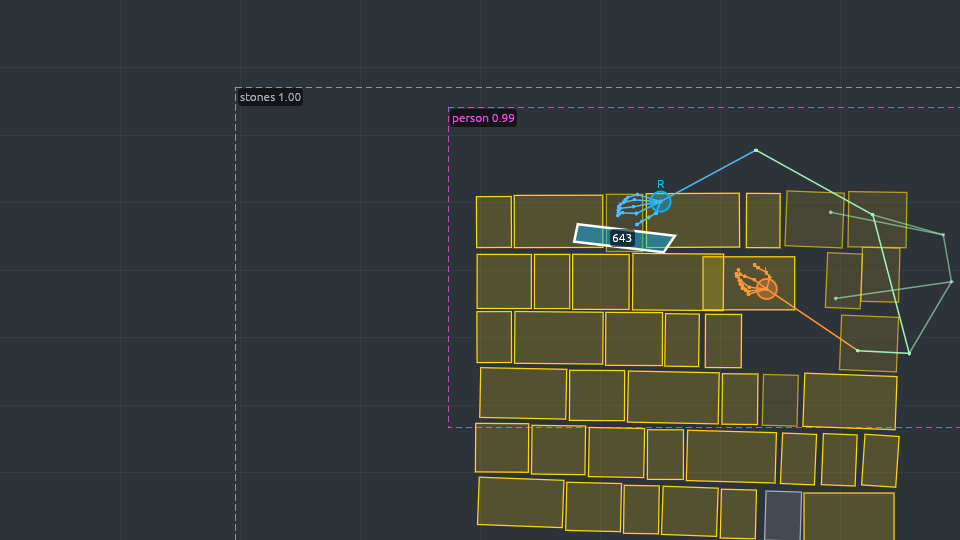
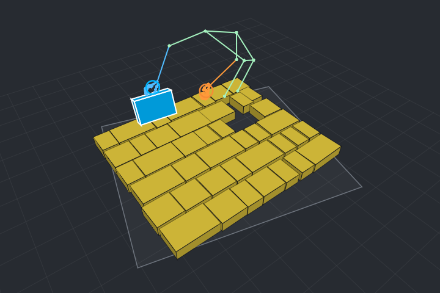
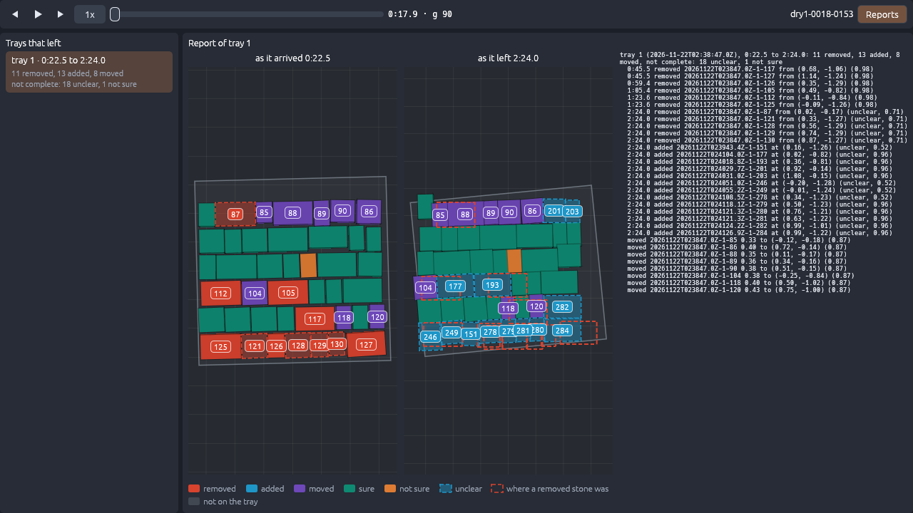

# Visualisation

Use `pdigger-factory-viz` to display a camera overlay, a 3D scene, hand activity or a tray report. The widgets draw
with egui’s painter and also render headlessly for tests. The Craft theme, buttons and layout come from TextureCraft
and craft-libs. [Third-party credits](../NOTICE).

```toml
[dependencies]
pdigger-factory-viz = { git = "https://github.com/eprojac/pdigger-factory-sdk-rust", tag = "v1.0.1" }
pdigger-factory-sdk = { git = "https://github.com/eprojac/pdigger-factory-sdk-rust", tag = "v1.0.1" }
egui = "0.37"
```

The crates are not on crates.io: take both from this repository at the same release tag.

Run `make pictures` to reproduce the screenshots headlessly. The camera views show frame 1516 of
`dry1-0296-0306-full` at 5:02.4, when the right hand carries stone 643. The tray report uses `dry1-0018-0153`.

## The viewer



`pdigger-factory-viewer <file | recording URL | unit URL>` opens a recording (a replay you can play, pause, step and
scrub, at 0.25x to 4x) or follows a unit's shared session live, streaming the world, cards, scene and overlay layers
(`VIEWER_LAYERS`). `ViewerApp` is the same app as a widget: `ViewerApp::open(&ViewerInput::parse(arg))` opens what the
viewer's argument names; `ViewerApp::from_replay(title, replay)` (the video size from the recording header's source),
`ViewerApp::from_updates(title, updates)` (or `from_updates_of(title, updates, native_wh)`) and
`ViewerApp::live(title, receiver)` (fed by `follow(interpreter)`, or by `follow_until(interpreter, stop)`, which also
ends as soon as `stop` completes, even while an idle unit sends nothing) build it from your own data; then call `app.ui(ui)`
each frame. Its parts:

- the top bar: previous frame, play or pause, next frame, speed, the scrub bar, the time and `g`, the title, the
  first problem of a live stream and the Reports button;
- the keys `[` and `]` (or Page Up and Page Down): the previous and the next tray point, where a tray had arrived and
  settled and where it was about to move out ([trays](interpreter.md#trays-and-tray-stones));
- the video-space overlay, the 3-D scene, the hand cards and the event feed, described below. Hovering a stone in the
  overlay or a line of the feed highlights that stone everywhere; otherwise the stone of the newest activity is;
- the Reports button: in place of the four views, the trays that left, each with its window and counts (a replay lists
  every tray of the recording that left, a unit followed its trays as they leave), and the report of the one picked as
  a [`ReportView`](#reportview-a-trays-report); it opens on the tray of the frame shown, and the button again goes back
  to the four views.

`ViewerApp` also has `seek`, `seek_time`, `advance(dt)`, `set_playing`, `set_speed`, `state()`, `feed()`,
`current()` (the `Step`: the frame, its overlay and scene draw lists, its update), `tray_marks()` (each tray's two
points as `TrayMark`s: `tray`, `arrived`, `at`, `index`), `next_tray_point()` and `previous_tray_point()`, `trays()`
(the trays that left, each with its report; `set_trays(trays)` lists others, such as `Replay::trays()` for a viewer
built from updates), `show_report(Some(index))` (`None`: the four views again), `report_index()` and `report_view()`
(the `ReportView` shown, its worlds from the frames the viewer holds: the leaving account supplies the final stones even after that frame expires), so you can drive it from code.

## `OverlayView`: the video space



`OverlayView::new(&overlay)` draws an `Overlay2D` (the r2d1 draw list of `renderOverlay2d`, or one built from a frame
by `draw::overlay_of_frame`): stone outlines in their style (held in the hand's colour, placed, detected, a model
pose, kept), the person and stone boxes, the skeleton (body, left and right hand bones), the wrist rings, the focus (a
render's focus outline, or a frame's focus path) and the primitives of `draw=primitives` renders, with their labels:
the ids of the held and highlighted stones, the wrists' L and R, the boxes' scores and the primitives' labels.
`.labels(false)` leaves the labels out, all but the name of the stone under the pointer (the TypeScript
`OverlayCanvas` writes only the boxes' and the primitives' labels, and its `labels: false` leaves those out);
`.highlight(Some(id))` outlines a stone, `.background(color)` sets the letterbox. `show(ui)` returns the response and
the stone under the pointer; `VideoTransform` maps native pixels to the screen and back.

## `SceneView`: the 3-D scene



`SceneView::new(&scene, &mut camera)` draws a `Scene3D` (the draw list of `renderScene3d`, or `draw::scene_of_frame`):
the board, shaded stones, the focus path (`focus.path3d`), the skeleton and the wrist rings through an `OrbitCamera`
(z up). Dogbones use the video overlay’s 12-vertex footprint, extruded to the solid’s height and rotated into its pose.
Rectangular stones use a four-corner footprint. Dragging orbits, scrolling zooms, a double click frames the scene again
(`OrbitCamera::framing`); `OrbitCamera::top` looks straight down.

## `EventFeed` and `HandCards`

`EventFeed::new(capacity)` keeps the newest lines (`push_update`, `push_event`, `push_activity`), newest first, each
with its hand's colour; two Craft icon buttons switch events and activities on and off, and hovering a line names its
stone. `HandCards::new(&state)` shows what each hand is doing: its state (`carry`), the cards layer's title
(`Holding a stone`) and the stone it holds.

## `ReportView`: a tray's report



`ReportView::new(&tray, &before, &after)` draws the report of a tray that has left (simple mode, `tray.report()`;
`None` for a tray without one): `before` and `after` are the 3-D draw lists of the world at its arrival point
(`tray.arrived`) and at its leaving point (`tray.leaving`), as `draw::scene_of_frame` makes them of the frames there. The leaving picture uses the final account for the stones,
their positions and their sizes. Where available, a matching solid supplies the orientation and height.
`show(ui)` takes the space left in `ui`; `paint(&painter, rect)` draws with a painter alone. It shows:

- the tray as it arrived on the left and as it left on the right, each from straight above under its title
  (`as it arrived 0:22.5`), every stone filled with the colour of what the report says of it (`REPORT_COLORS`, the
  same as the TypeScript SDK's `TrayReportView`): red `#D8432E` removed, blue `#1E96C8`
  added, violet `#6E48B9` moved, green `#0E8A72` sure, amber `#DE7C34` not sure. An unclear removal or addition is
  translucent with a dashed outline, and a world stone outside the arrival account is dimmed grey;
- on each stone removed, added or moved, its label: its tray stone id after the tray's number, the world id it was
  first seen under (with `-2` for a second stone first seen under it in the same tenth of a second); on the side as it
  left, a dashed red outline at each removed stone's final place (`TrayChange::place` and `size`, axis-aligned: its
  long side along x, or along y when its world stone lay that way as the tray arrived);
- a legend under the sides, and the report's text (`TrayReport::describe`) beside them in a wide rectangle, else under
  them, scrolling when it does not fit.

`report_marks(&tray)` gives the marks behind the colours as data, `ReportMarks { before, after }`, maps by world id:
`before` holds every stone the tray arrived with, by the world id it was first seen under, and `after` every stone on
the tray as it left, by the world id it stands for then. A `ReportMark` has the tray stone's id (`stone`), its `role`
(`ReportRole::Removed`, `Added`, `Moved`, `Sure` or `Unsure`, with `color()` and `label()`), whether it is `certain`
(false only for an unclear removal or addition) and its `label` (empty for sure and not sure). `SceneView::tint`
colours the stones of any scene view the same way.

The fixture recording's tray 1 arrives at 0:22.5 with 42 stones. Its final account at 2:24.0 has 44 stones, with six
certain removals, five unclear removals, thirteen unclear additions and eight moves. The camera check found 44 at
departure, eight removals and ten placements. It confirmed all six certain removals; the other two removals are among
the five unclear ones, and ten of the thirteen unclear additions are the worker's placements (the other three came in
on the tray). The SDK links 31 stones to the arrival account, the unit's speckle check confirming or finding again most
of the stones the worker pushed as the tray left: 30 have sure identities, eight of them moved, and one has an
uncertain identity.

## Rendering without a window

`raster::render(&ctx, size, pixels_per_point, passes, |ui| ...)` runs a widget for a few frames in an egui context and
rasterises the result in software (`Snapshot`: `pixel`, `count_not`, `to_png`). The tests use it to check what the
widgets paint, and the pictures of the docs come from it:

<!-- example: crates/pdigger-factory-viz/examples/screenshots.rs -->
```rust
//! Renders the pictures of the docs headless (no window, no GPU) from the fixture recording
//! `dry1-0296-0306-full`: the viewer, the video-space overlay and the 3-D scene at g 1516 (the
//! right hand carries stone 643), and the output of the replay quickstart as an SVG; then the
//! viewer's reports on `dry1-0018-0153`, whose tray 1 arrives at 0:22.5 and leaves at 2:24.0.
//!
//!     cargo run -p pdigger-factory-viz --example screenshots -- docs/img
use std::path::{Path, PathBuf};

use egui::vec2;
use pdigger_factory_sdk::{Replay, Side};
use pdigger_factory_viz::craft::{Accent, Brightness, theme};
use pdigger_factory_viz::raster::render;
use pdigger_factory_viz::{OrbitCamera, OverlayView, SceneView, ViewerApp};

const RECORDING: &str = "dry1-0296-0306-full";
const FIXTURES: &str = "fixtures/recordings";

fn context() -> egui::Context {
    let ctx = egui::Context::default();
    theme::apply(&ctx, Brightness::MediumDark, Accent::Copper);
    ctx
}

fn main() -> Result<(), Box<dyn std::error::Error>> {
    let out = PathBuf::from(std::env::args().nth(1).unwrap_or_else(|| "docs/img".to_string()));
    std::fs::create_dir_all(&out)?;
    let recording = format!("{FIXTURES}/{RECORDING}.ndjson.gz");
    let mut app = ViewerApp::from_replay(RECORDING, Replay::open(&recording)?)?;
    app.seek_time(302.3);
    let step = app.current().expect("the recording has frames");
    let (g, overlay, scene) =
        (step.frame.g, step.overlay.clone().expect("a world"), step.scene.clone().expect("a scene"));
    let write = |name: &str, png: Vec<u8>| -> std::io::Result<()> {
        let file = out.join(format!("{name}-{RECORDING}-g{g}.png"));
        std::fs::write(&file, png)?;
        println!("{}", file.display());
        Ok(())
    };
    write("viewer", render(&context(), vec2(1280.0, 720.0), 1.0, 3, |ui| app.ui(ui)).to_png())?;
    let view = OverlayView::new(&overlay).labels(true).highlight(Some(643));
    write("overlay", render(&context(), vec2(960.0, 540.0), 1.0, 2, |ui| drop(view.show(ui))).to_png())?;
    let mut camera = OrbitCamera::framing(&scene);
    let shot = render(&context(), vec2(720.0, 480.0), 1.0, 2, |ui| {
        drop(SceneView::new(&scene, &mut camera).highlight(Some(643)).show(ui))
    });
    write("scene", shot.to_png())?;
    let svg = out.join("quickstart-output.svg");
    std::fs::write(&svg, terminal(&recording)?)?;
    println!("{}", svg.display());
    // the Reports button: the trays that left and the report of the first
    let mut reports =
        ViewerApp::from_replay("dry1-0018-0153", Replay::open(format!("{FIXTURES}/dry1-0018-0153.ndjson.gz"))?)?;
    reports.show_report(Some(0));
    let file = out.join("reports-dry1-0018-0153.png");
    std::fs::write(&file, render(&context(), vec2(1280.0, 720.0), 1.0, 3, |ui| reports.ui(ui)).to_png())?;
    println!("{}", file.display());
    Ok(())
}

/// The output of `examples/replay.rs` over `recording` as a terminal picture: the command, the
/// activities (in their hand's colour) and the summary.
fn terminal(recording: &str) -> pdigger_factory_sdk::Result<String> {
    let out = Replay::open(recording)?.run()?;
    let command = format!("$ cargo run --example replay -- {}", Path::new(recording).display());
    let mut lines = vec![(command, "#c9a27a")];
    for activity in &out.activities {
        let colour = match activity.hand() {
            Some(Side::Left) => "#f68c36",
            Some(Side::Right) => "#51bcff",
            _ => "#e6e8ea",
        };
        lines.push((activity.describe(), colour));
    }
    lines.extend(out.summary.describe().lines().map(|l| (l.to_string(), "#a4b0ba")));
    let (width, line_height, top) =
        (8.2 * lines.iter().map(|(l, _)| l.chars().count()).max().unwrap_or(40) as f64 + 48.0, 19.0, 48.0);
    let height = top + line_height * lines.len() as f64 + 20.0;
    let mut svg = format!(
        "<svg xmlns=\"http://www.w3.org/2000/svg\" width=\"{width:.0}\" height=\"{height:.0}\" viewBox=\"0 0 {width:.0} {height:.0}\" role=\"img\" aria-label=\"Output of the replay quickstart over {RECORDING}\">\n\
         <rect width=\"100%\" height=\"100%\" rx=\"10\" fill=\"#1b1f24\"/>\n\
         <circle cx=\"20\" cy=\"18\" r=\"5\" fill=\"#ed6a5e\"/><circle cx=\"38\" cy=\"18\" r=\"5\" fill=\"#f5bf4f\"/><circle cx=\"56\" cy=\"18\" r=\"5\" fill=\"#61c454\"/>\n\
         <text font-family=\"ui-monospace, SFMono-Regular, Menlo, Consolas, monospace\" font-size=\"13\" xml:space=\"preserve\">\n"
    );
    for (i, (line, colour)) in lines.iter().enumerate() {
        let y = top + line_height * i as f64;
        svg += &format!("<tspan x=\"24\" y=\"{y:.0}\" fill=\"{colour}\">{}</tspan>\n", escape(line));
    }
    svg += "</text>\n</svg>\n";
    Ok(svg)
}

fn escape(text: &str) -> String {
    text.replace('&', "&amp;").replace('<', "&lt;").replace('>', "&gt;")
}
```

## Colours and topology

`draw` holds the shared palette and topology (from `getTopology`): left hand `#f68c36`, right hand `#00b5ff`, stones
`#ffd60a`, stone boxes `#a4b0ba`, person box `#ed50e9`, focus `#ff4fc8`, and the skeleton's bones. `craft::theme::apply`
sets the Craft theme on a context (`Brightness`, `Accent`); `craft::Tokens` are its colours.
